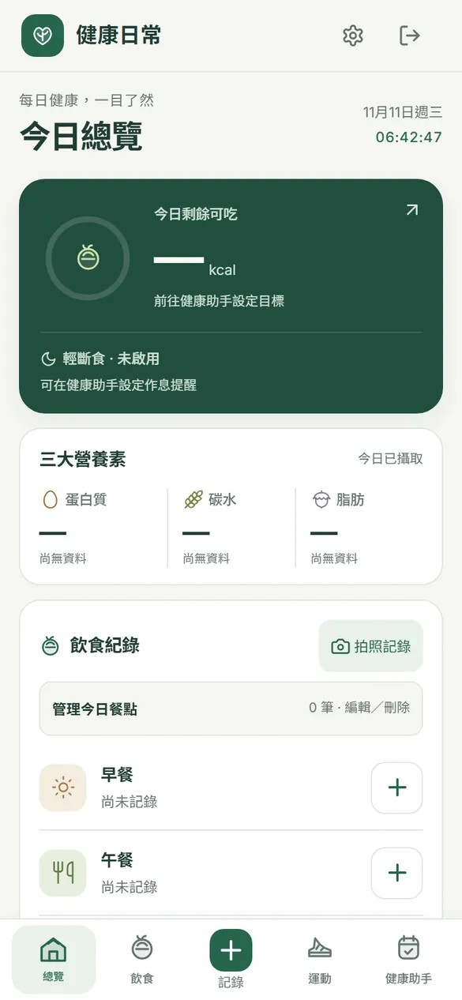
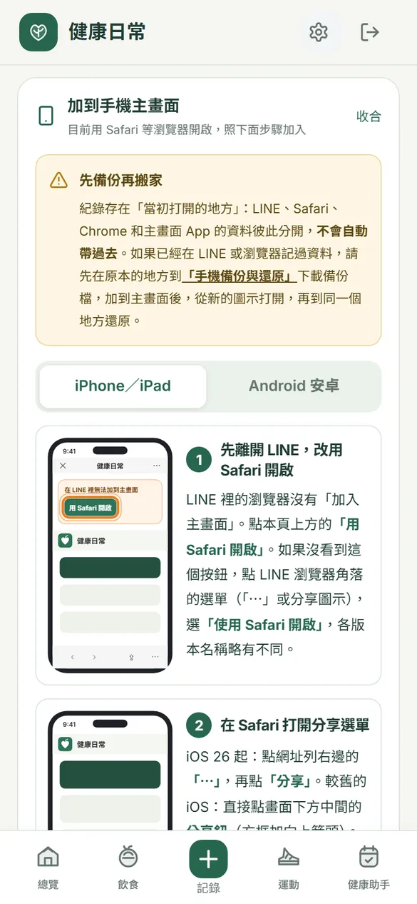
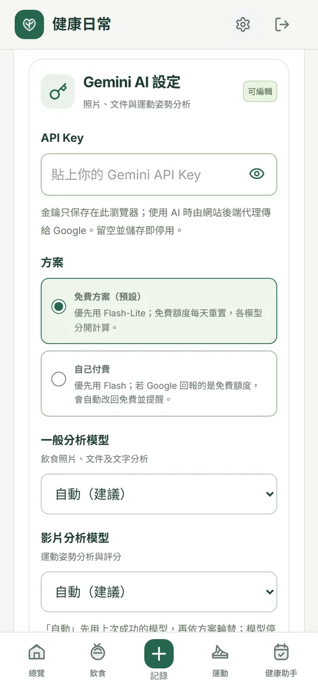
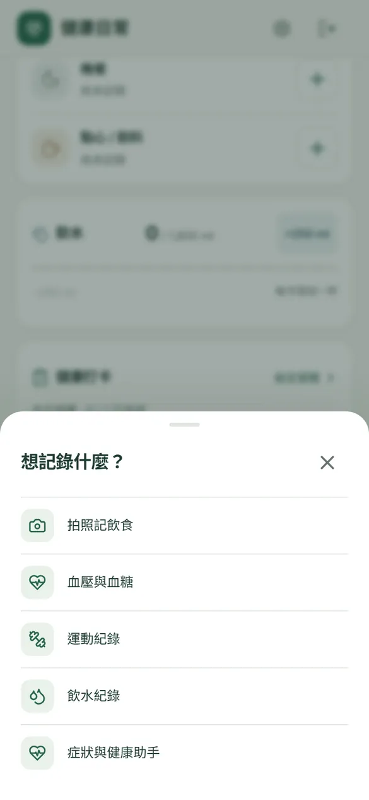
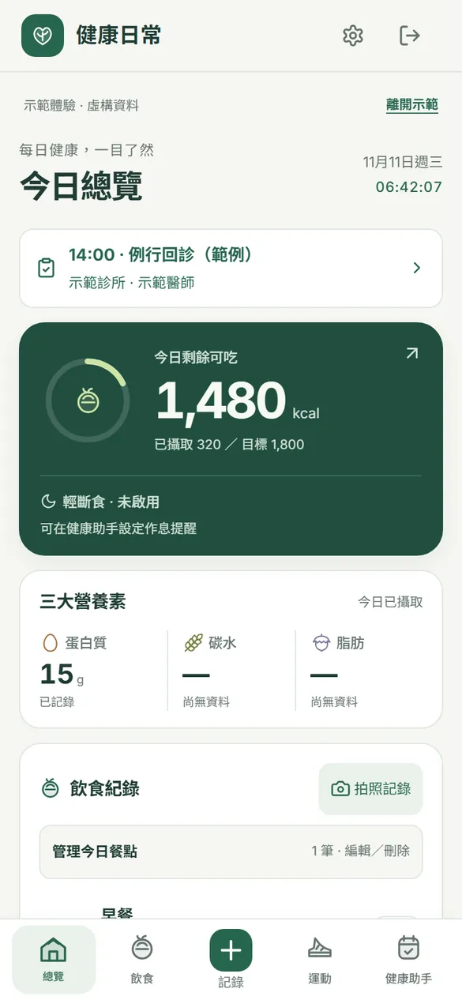
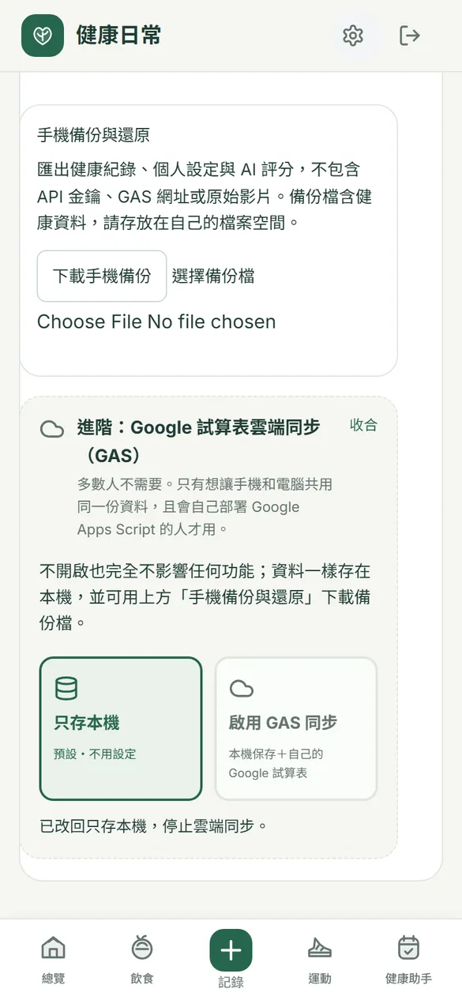

# 健康日常｜圖文使用說明

> 拍一下，三餐健康全記錄。
>
> 正式網址：<https://healthcona.netlify.app/>
> 先試玩（虛構示範資料，不會動到自己的紀錄）：<https://healthcona.netlify.app/?demo=1>
> 完整線上說明：<https://healthcona.netlify.app/guide/>

## 系統簡介

「健康日常」是給老師自己用的手機健康管理網頁，打開就能用，不用註冊帳號。

- **拍照記飲食**：拍下餐點，AI 估算熱量與三大營養素，用紅黃綠燈提醒吃得健不健康；不想用 AI 也可以手動記錄。
- **一站管理健康**：三餐、喝水、運動、血壓血糖、用藥打卡、回診預約、輕斷食倒數都在同一個地方，連續達標還有獎勵徽章。
- **資料留在自己手機**：紀錄只存在這支手機的瀏覽器，不會上傳到網站的伺服器；可以加到手機主畫面當 App 用，有五種外觀可選。

## 使用前準備

| 項目 | 需要嗎？ | 說明 |
| --- | --- | --- |
| 手機與瀏覽器 | 需要 | iPhone 用 Safari，Android 用 Chrome。電腦也能開，但以手機操作為主。 |
| Google 帳號 | 只有用 AI 時需要 | 要用「拍照分析」時，用自己的 Google 帳號到 [Google AI Studio](https://aistudio.google.com/apikey) 申請免費的 Gemini API 金鑰。只手動記錄就不需要。 |
| LINE 官方帳號 | 不需要 | 從 LINE 點開連結也能用，但建議改用 Safari／Chrome 開啟再加到主畫面（見步驟 2）。 |
| 授權步驟 | 不需要 | 不用登入、不用授權。只有進階的「Google 試算表雲端同步」需要自己部署 Apps Script，多數人用不到。 |

## 操作教學

### 步驟 1：打開網址

用手機打開 <https://healthcona.netlify.app/>，就會看到「今日總覽」。第一次打開還沒有任何紀錄，是正常的。

### 步驟 2：加到手機主畫面

點右上角齒輪進入「設定」，展開「加到手機主畫面」，依 iPhone 或 Android 的圖文步驟操作。之後都從主畫面的圖示打開。

> 從 LINE 點開時，LINE 的瀏覽器沒辦法加到主畫面，請照提示改用 Safari 或 Chrome 開啟。LINE、Safari、Chrome、主畫面 App 的資料彼此分開，請固定從同一個地方打開。

### 步驟 3（選用）：貼上 Gemini 金鑰，開啟 AI 拍照分析

在「設定 → Gemini AI 設定」貼上自己的 API 金鑰，方案保持「免費方案」，模型選「自動（建議）」，按「確認」測試能不能用。卡片下方有「免費額度、申請教學與隱私說明」可以展開看。

### 步驟 4：按「＋」開始記錄

點畫面下方中間的「＋」，選要記錄的項目：拍照記飲食、血壓與血糖、運動紀錄、飲水紀錄、症狀與健康助手。

### 步驟 5：回總覽看今天的進度

「今日總覽」會顯示今天剩多少熱量可吃、三大營養素、輕斷食倒數、用藥打卡與回診提醒。到「健康助手」填好身高、體重與目標，熱量目標才會自動算出來。

### 步驟 6：每週下載一次備份

到「設定 → 手機備份與還原」按「下載手機備份」，把備份檔存到自己的雲端硬碟或電腦。換手機時，在新手機選「選擇備份檔」還原即可。

## 注意事項

- **資料存放位置**：健康紀錄只存在這支手機的瀏覽器裡。清除瀏覽器資料或刪掉 App，紀錄會一起消失，請定期下載備份檔。
- **AI 會把照片傳給 Google**：使用拍照分析時，那一張照片或那段文字會送給 Google 分析。請避免拍到姓名、身分證字號等個資；健檢報告先遮住個資再拍。
- **金鑰與額度**：金鑰只存在自己手機，不要傳給別人。免費額度每天有上限，用完隔天恢復；手動記錄不受影響。
- **不是醫療診斷**：AI 結果只供一般健康管理參考，身體不適請就醫。
- **跨裝置同步（進階）**：想讓手機和電腦共用資料，可在設定最下方的「進階」連到自己的 Google 試算表，必須設定存取密碼。一般使用不需要。
